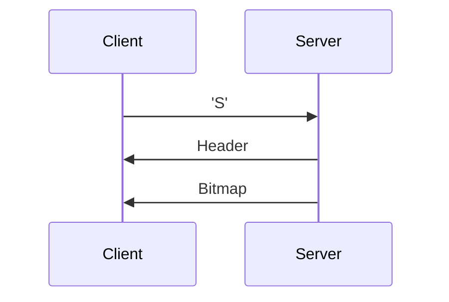

# Simple Linux screenshot client for embedded devices

This Linux desktop client implements a simple protocol for fetching a binary RGB screenshot over a serial port. 
After the bitmap is retrieved it is saved as a PNG file using the stb_image_writer facility from https://github.com/nothings/stb.
Other output formats could be trivially added by using the appropriate STB conversion function.

# Protocol

The embedded device needs to be running server logic that waits for a screenshot command, and then responds with a short header followed by the raw RGB bitmap. The transfer is slow - a 320x240 image takes about 10s even at 921600bps - but 
I have found it to be reliable enough without any checksum or retransmit logic. For performance reasons there is no handshaking - it is expected that the Linux client can keep up with whatever rate the embedded device can transmit at.

## Sequence Diagram 

Where Header consists of:

| Offset | Value | Description |
| --- | --- | --- |
| 0 | 'V' | Protocol version |
| 1 | 1 | Currently only version 1 is supported |
| 2 | 'W' | Bitmap width |
| 3 | x | width >> 8 |
| 4 | x | width & 0xff |
| 5 | 'H' | Bitmap height |
| 6 | x | height >> 8 |
| 7 | x | height & 0xff |
| 8 | 'Y' | Color depth |
| 9 | 24 | Currently only 24-bit RGB is supported |
| 10 | 'D' | Start of bitmap data. Width * Height * 3 bytes of data follow |

The Client can also send 'X' at any point to abort the transfer.

